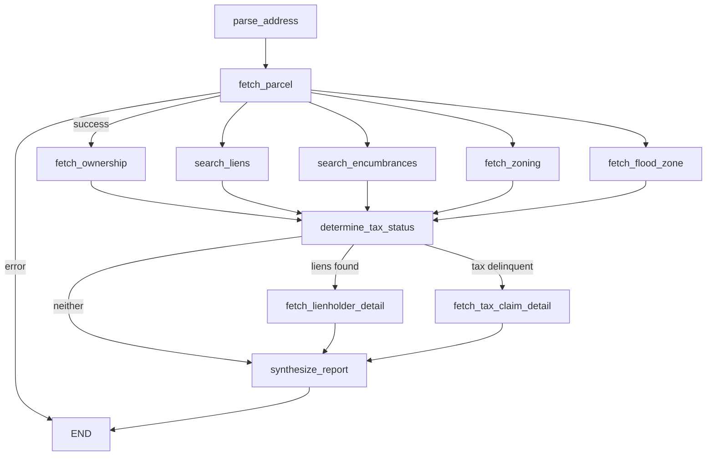

# TitleTrace

[](https://github.com/coreystevensdev/titletrace/actions/workflows/ci.yml)


Property title search as a LangGraph agent. Feed it a PA or NJ address; it fans out 5 parallel data lookups, determines tax status from the results, conditionally drills into lienholder detail and tax delinquency, then synthesizes a structured title report via Claude. 122 tests (pytest + respx).

A title search is what you run before buying property, and the reason it matters is that an unpaid lien the search misses becomes the new owner's debt.

**[Try it: titletrace.coreystevens.dev](https://titletrace.coreystevens.dev/)**, no signup: the page shows the five lookups running in parallel and the drill-down branch skipping itself when nothing is encumbered.

```bash
docker compose up --build
curl -X POST localhost:8000/api/trace \
  -H 'Content-Type: application/json' \
  -d '{"address": "1234 Market St, Philadelphia, PA 19107"}'
```

## Problem

Title searches in PA and NJ require pulling data from five separate sources: parcel registries, lien databases, tax records, zoning classifications, and FEMA flood zone maps. A human title examiner checks each source manually and writes a narrative summary. The process takes hours and is error-prone when any single source returns stale data.

## Solution

A LangGraph state machine runs the lookups concurrently. Philadelphia properties route through the free OPA (Office of Property Assessment) and OpenDataPhilly APIs; all other PA and NJ properties use ATTOM Data. Flood zone comes from the FEMA NFHL client, called with the coordinates each parcel lookup now returns: ATTOM's `location.latitude`/`longitude` fields for non-Philadelphia PA and NJ parcels, and OPA's `lat`/`lng` fields for Philadelphia (see Known Limitations for the caveat on that second source). Tax delinquency outside Philadelphia is derived from ATTOM's lien records rather than left unimplemented, since ATTOM has no dedicated tax-status endpoint on its free tier. After the parallel fan-out completes, Claude synthesizes a structured `TraceReport` via forced tool call, surfacing data gaps explicitly rather than hallucinating over missing fields.

## Architecture



Claude is called only once, in `synthesize_report`, with a forced `submit_report` tool call. The prompt carries named fields pulled out of each vendor response, never the raw payloads and never API credentials. It does carry the address, the owner name and any lienholder names, so that is a narrowing of what reaches the model rather than a guarantee that nothing identifying does.

### Data source routing

| Coverage | Parcel + Owner | Tax | Liens | Zoning | Flood Zone |
|---|---|---|---|---|---|
| Philadelphia | OPA (free) | OPA (free) | ATTOM | ATTOM | FEMA NFHL, via OPA coordinates (unverified, see Known Limitations) |
| PA (non-Philly) | ATTOM | derived from ATTOM lien records | ATTOM | ATTOM | FEMA NFHL, via ATTOM coordinates |
| NJ | ATTOM | derived from ATTOM lien records | ATTOM | ATTOM | FEMA NFHL, via ATTOM coordinates |

## Tech Stack

| Layer | Technology | Why |
|---|---|---|
| Agent framework | LangGraph, pinned `>=1.0.10,<2` | Parallel Send API fans out across 5 data nodes concurrently; LangSmith traces every run |
| LLM | Claude via Anthropic SDK | Forced tool call (submit_report) guarantees structured output; prompt carries extracted fields, not raw vendor payloads or credentials |
| API | FastAPI + uvicorn | Async-native, Pydantic schema validation, auto-generated OpenAPI docs |
| HTTP | httpx.AsyncClient | Single shared connection pool across all 5 concurrent lookups; 30s timeout + exponential backoff on 429/503 |
| Data (Philadelphia) | OPA + OpenDataPhilly | Free Socrata endpoints, no key required; best parcel coverage for Philadelphia |
| Data (PA/NJ) | ATTOM Data API | Single vendor covering parcel, ownership, liens, encumbrances, and zoning across PA and NJ |
| Flood zone | FEMA NFHL ArcGIS REST | Public endpoint, no key, authoritative FIRM panel designation. Queried with the coordinates returned by whichever parcel lookup ran (ATTOM or OPA) |
| Tests | pytest + respx | respx intercepts httpx at the client level so all API calls are mocked without touching the network |
| Packaging | hatchling | PEP 517 build, `pip install -e .` for local dev |

## Getting Started

Requires `ANTHROPIC_API_KEY`. ATTOM coverage requires `ATTOM_API_KEY` (200 free calls/month at api.attomdata.com).

```bash
cp .env.example .env
# edit .env with your keys
docker compose up --build
```

Or run without Docker:

```bash
pip install -e ".[dev]"
uvicorn titletrace.api.main:app --reload
```

API: `POST /api/trace` with `{"address": "123 Main St, Philadelphia, PA 19103"}`

Full OpenAPI schema at `localhost:8000/docs` when running.

## Tests

```bash
pip install -e ".[dev]"
pytest -v
```

All 122 tests run without any API keys; CI runs with `-m "not integration"`. The `integration` marker is registered in `pyproject.toml` for future tests against live ATTOM data -- none are written yet:

```bash
INTEGRATION=true pytest -v -m integration
```

## Eval

Two harnesses, and they measure different things. One grades the report that comes out. The other grades the route the graph took to produce it, which is where the failures specific to an agent live.

### Output eval

Runs the full pipeline against 5 golden-dataset addresses and scores parse accuracy, parcel found rate, and error detection:

```bash
pip install -e ".[dev]"
python eval/eval.py
# results written to eval/results.json
```

Requires both API keys for non-error cases to score parcel_found_rate above 0%.

### Trajectory eval

```bash
PYTHONPATH=src python -m eval.trajectory
```

No API keys, no cost, so it runs in CI on every commit and fails the build. It replays the three recorded addresses and scores seven properties of the path rather than of the answer:

| Check | What a failure means |
|---|---|
| `fanout_complete` | A parallel lookup stopped running and the report is quietly thinner |
| `fanout_once_each` | A node ran twice, which is a duplicate vendor call |
| `fanin_once` | `determine_tax_status` fired before all five returned |
| `drilldown_matches_data` | The conditional branch disagrees with the data it was branching on |
| `terminates_in_synthesis` | The graph ended somewhere other than the report |
| `no_undeclared_nodes` | A node ran that this eval does not know about |
| `vendor_routing` | Philadelphia left the OPA path, or a non-Philadelphia parcel left ATTOM |

The one that justifies the harness is `drilldown_matches_data`. The expectation is derived from the state the trace collected, not written down per address: `fetch_lienholder_detail` should run exactly when liens were found and `fetch_tax_claim_detail` exactly when the parcel came back delinquent. So the expectation comes from the data and the observation comes from the node trace, and `_route_after_fanin` is what has to agree with both. Hardcoding "Philadelphia runs both drill-downs" would keep passing with the routing predicate inverted.

Confirmed by breaking it. Inverting the liens condition takes it to 0 of 3 on `drilldown_matches_data`, because the clean parcel then queries a vendor for detail on liens that do not exist. Removing `fetch_zoning` from the `Send` fan-out takes it to 0 of 3 on `fanout_complete`. `tests/test_trajectory_eval.py` holds those cases as unit tests against the scorer, so a vacuous rewrite of the scoring fails the suite instead of reporting a clean sweep.

What it does not measure is wall-clock parallelism. It asserts that the five fan-out nodes run between the parcel fetch and the fan-in and that the fan-in runs once after all five, which is the graph contract. Whether they overlapped in time is not observable against a transport that answers in microseconds.

## Public demo

A browsable page at `/`: type an address, or take one of the three quick-picks, and the trace renders as the graph produced it. Parcel first, then the five parallel lookups shown as five, then the conditional drill-down, which visibly does not run when nothing is encumbered.

The live trace cannot sit on an open URL. ATTOM's free tier is 200 calls a month and the synthesis step spends money per request, so anyone holding the button down would exhaust both.

`POST /api/demo/trace` runs live when both keys are configured and the model budget holds, and falls back to recorded vendor responses otherwise. The response names which mode produced it and why, because a recorded trace presented as a live one is a claim the deployment has not earned.

The recordings are injected at the transport layer with `httpx.MockTransport`, not by stubbing the clients. Retry and status classification, each client's parsing, the five-way fan-out, the fan-in and the conditional drill-down all run exactly as they would against the real vendors. What the recordings assert is only what a vendor said; every derived figure on the page is derived by the code that would derive it in production.

Three addresses are recorded, chosen to take different paths rather than to look impressive:

| Address | Route | What it exercises |
| --- | --- | --- |
| 1201 Chestnut St, Philadelphia PA | OPA | The Philadelphia branch, tax delinquency from OPA, drill-down on two liens |
| 45 Lafayette Ave, Haddonfield NJ | ATTOM | Clean title, so the drill-down branch is skipped |
| 812 Morris Rd, Wayne PA | ATTOM | Two liens and an easement, delinquency derived from the lien list |

Synthesis is the one step not recorded. It calls Claude, and a response written by hand here would read as model output. In recorded mode the demo returns the real assembled prompt instead, which is `_build_prompt` running on the real traced state.

### Budget

Spend is guarded by [rolling-cost-cap](https://pypi.org/project/rolling-cost-cap/), checked before the call rather than after. `evaluate()` records a cost that has already left your account, which is the right shape for metering and the wrong one for a public URL. The node asks `check()` with a conservative estimate first, refuses if the budget is gone, and records the real token cost afterwards.

| Variable | Default | What it does |
| --- | --- | --- |
| `TITLETRACE_MONTHLY_BUDGET_USD` | `5.00` | Hard stop for the month. Past it the demo serves recordings. |
| `TITLETRACE_CALL_CEILING_USD` | `0.25` | Refuses any single call estimated above this. |
| `TITLETRACE_LIVE_TRACES_PER_MONTH` | `30` | Protects ATTOM's 200-call free tier, which has no dollar cost for the budget to see. |
| `TITLETRACE_SPEND_LEDGER` | `/tmp/titletrace-spend.json` | Where the month's spend is kept across restarts. |
| `TITLETRACE_QUOTA_LEDGER` | `/tmp/titletrace-quota.json` | Where the live-trace count is kept across restarts. |

Three things make that number mean something.

The judgement and the reservation happen together under a lock, before the call. `check()` then call then `record()` leaves an await between the decision and the accounting, so every request in flight reads the same unspent budget: with the lock removed, twenty concurrent requests all clear a budget that affords about six. The lock covers two in-memory operations, not the model call, so concurrency survives.

The reservation is the estimate and is never reconciled downwards, because the ledger is append-only. The estimate assumes the full `max_tokens`, so the budget drains ahead of real spend. That also means a call that times out is already paid for, which is correct: a timeout is not proof the tokens went unbilled.

Spend is written to a file and reloaded at boot, because a container with `--restart=always` that crash-loops would otherwise be handed a fresh budget on every boot. A ledger that cannot be read is treated as a spent budget rather than an empty one.

The trace quota keeps an in-process counter as a floor under the file. Reading the count back from storage alone means a write that failed leaves it at zero forever and live mode never stops, so a ledger that cannot be written switches live mode off rather than handing out an unbounded number of traces.

One cap per process, not per request: a per-request cap caps nothing, since every visitor would arrive with a fresh budget. State is still per-process, so N workers can collectively spend N times the budget, which is the trade-off the library's own README names. This deployment runs one.

## Known Limitations

- Philadelphia's flood-zone coordinates come from OPA's `lat`/`lng` fields, and that field-name assumption has never been confirmed against a live response: `data.phila.gov` returned HTTP 403 to the development sandbox's IP while this was being built. Non-Philadelphia coordinates come from ATTOM's `location.latitude`/`longitude` fields, which are documented and confirmed working.
- Non-Philadelphia tax delinquency is inferred from a recorded ATTOM tax lien rather than a dedicated tax-status field, since ATTOM's free tier doesn't expose one. A lien can take time to reach ATTOM's `/alllien/detail` index after a county records it, so a property can be delinquent at the tax office before this lookup reflects it -- the same recording-lag gap `fetch_tax_claim_detail_attom` already documents for its own lien-detail lookup.
- A vendor failure degrades the report rather than ending the trace: each node catches, logs, and leaves its slice of the state empty, which then shows up in the report's `data_gaps`. The cost is that a partial report and a complete one look alike until you read that list, so `confidence` is the field worth checking first.
- Three call sites hit ATTOM's `/alllien/detail` per trace: the shared lien fetch, `fetch_lienholder_details_attom`, and `fetch_tax_claim_detail_attom`. It was four until `_inflight_lien_fetches` keyed an `asyncio.Task` by `(apn, state)`, so `search_liens_attom` and `search_encumbrances_attom` now await one in-flight request instead of two. Collapsing the remaining three would need the drill-downs to read from the first fetch's result rather than re-querying for richer fields.
- The flood lookup is two FEMA calls, not one: the zone is on NFHL layer 28 and the FIRM panel and its effective date are on layer 3. FEMA needs no key and sets no quota, but a panel-layer failure drops the provenance while keeping the zone.
- ATTOM free tier allows 200 calls/month. A worst-case non-Philadelphia trace makes 6 ATTOM calls (parcel, ownership, one coalesced lien fetch, zoning, lienholder detail, tax-claim detail), because `_route_after_fanin` queues both drill-downs when liens exist and the parcel is delinquent. That is about 33 traces/month before billing, not the ~40 this line claimed off a count of 5.
- LangGraph state merging in the parallel fan-out uses last-write-wins for scalar fields. If two nodes set the same key, the later-resolving node wins. List fields (liens, encumbrances, ownership_history) are each owned by exactly one node, so no collision occurs in practice.
- LangSmith tracing requires `LANGSMITH_API_KEY` and `LANGCHAIN_TRACING_V2=true`. Without it, traces are not persisted.
